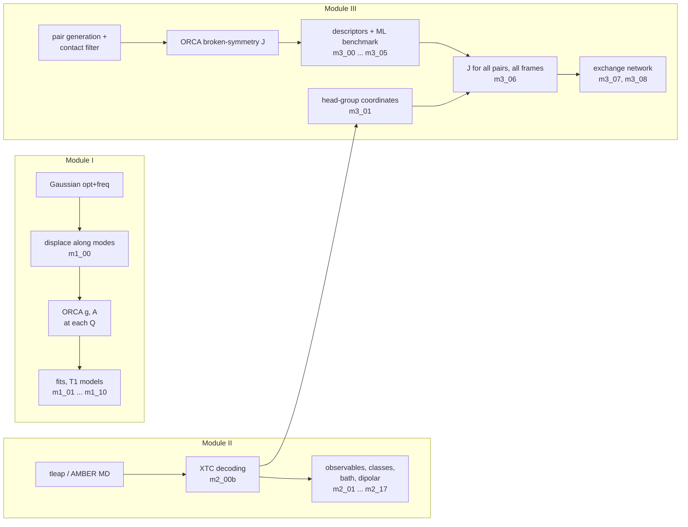

# Noise in Qubits: an atomistic view of a dense radical spin-qubit monolayer on gold

This repository contains everything needed to reproduce the calculations and analyses behind our study of the TEMPO-functionalized self-assembled monolayer (SAM) on gold reported by Tesi et al. (*Adv. Mater.* **2023**, *35*, 2208998). It includes the input files, the analysis code, the processed data and step-by-step instructions.

In this monolayer, the nitroxide radicals keep phase memory times of 6–14 µs despite dense packing. We ask three questions about it:

1. **Spin–lattice relaxation:** which vibrations modulate the spin Hamiltonian, and do they explain the measured T₁(T)?
2. **Structure and motion:** how are the radicals arranged and how do they move, at 100 and 300 K?
3. **Exchange coupling:** how strongly are neighboring radicals exchange-coupled, with which sign, and how does motion modulate the coupling?

The work has three parts, called "modules" throughout the code:

| Module | Method | Main output |
|---|---|---|
| **I. Spin–phonon coupling** | DFT normal modes (Gaussian 16) + g and A tensors along displaced geometries (ORCA 5, B2PLYP/EPR-II); fits of the experimental T₁(T) | mode-resolved ∂g/∂Q, ∂A/∂Q; relaxation-active vibrations |
| **II. Molecular dynamics** | All-atom MD of 141 radicals on Au (AMBER 18, GAFF + INTERFACE FF), 3 replicas × (100, 300 K) × 10 ns | structure, dynamics, radical classes, proton bath, dipolar couplings |
| **III. Exchange + machine learning** | 1364 broken-symmetry DFT couplings (B2PLYP-D3(BJ)/EPR-II), 11 ML regressors, sign classifiers, application to every radical pair in the trajectories | time-resolved exchange networks, ferro/antiferromagnetic statistics |



---

## Repository layout

```
Noise_In_Qubits/
├── README.md                    this file
├── requirements.txt / environment.yml
├── run_all.sh                   runs every stage that can be run from the repository
├── docs/                        detailed documentation (theory, inputs, every script)
│   ├── 00_installation.md
│   ├── 01_spin_phonon_coupling.md
│   ├── 02_molecular_dynamics.md
│   ├── 03_exchange_coupling_and_ML.md
│   ├── 04_running_the_analysis.md
│   └── 05_data_dictionary.md
├── python_codes/                all analysis code (m1_*, m2_*, m3_*), config.py, plot_style.py
│   └── xtc_reader/xtc2bin.c     stand-alone GROMACS-XTC decoder (C, no dependencies)
├── simulation_inputs/
│   ├── ModuleI/                 exported scan notebook, mode compositions, Wigner samples, templates/
│   ├── ModuleII/                tleap, force-field files, topologies, AMBER inputs, job scripts
│   └── ModuleIII/               pair generator, contact filter, ORCA inputs/job script, 1364 geometries, J values
├── data/                        processed data (module1, module2, module3) — inputs for figures and tables
├── Figures_MS/  Figures_ESI/    created by the figure scripts
└── tables/                      LaTeX tables created by the table scripts
```

## Quick start

```bash
git clone https://github.com/compchemsk/Noise_In_Qubits.git
cd Noise_In_Qubits
conda env create -f environment.yml && conda activate noise-in-qubits     # or: pip install -r requirements.txt
bash run_all.sh            # everything that does not need the raw MD trajectories (~30 min on 2 cores)
```

`run_all.sh` regenerates all Module I results, all Module III machine-learning results, the exchange-network statistics, and every figure and table from the processed data in `data/`. The steps that read the raw trajectories (about 23 GB, not stored on GitHub) are described in [docs/04_running_the_analysis.md](docs/04_running_the_analysis.md).

## Key results

| Quantity | 100 K | 300 K |
|---|---|---|
| Interior chain tilt | 20 ± 3° | 27 ± 1° |
| N–O order parameter S² (cone semi-angle) | 0.945 ± 0.007 (10°) | 0.72 ± 0.03 (26°) |
| Mean nearest-neighbor spin–spin distance | 6.26 ± 0.03 Å | 6.72 ± 0.07 Å |
| Local dipolar width √M₂ (B₀ ∥ normal) | 251 ± 15 MHz | 212 ± 13 MHz |
| Protons 4–8 Å from each spin | 58 ± 1 | 53 ± 1 |
| Resolved exchange couplings (\|J\| > 0.1 cm⁻¹) | 63 ± 2 pairs | 51 ± 7 pairs |
| Radicals without a resolved exchange partner | 32 ± 1 % | 46 ± 6 % |
| Antiferromagnetic share of resolved couplings | 76 ± 1 % | 75 ± 1 % |
| Median resolved ⟨\|J\|⟩ | 0.21 cm⁻¹ | 0.17 cm⁻¹ |

Values are means ± SD over three replicas. Other results:

- **ML model on held-out DFT pairs:** R² = 0.77 for asinh(\|J\|/0.05 cm⁻¹), and 70 % of resolved couplings are predicted within a factor of 3.
- **Sign of J:** essentially not learnable from geometry (AUC 0.50–0.63 across 16 classifiers).
- **Relaxation:** the measured T₁(T) requires ring- and methyl-dominated modes at about 80–160 cm⁻¹.

## Conventions

- Exchange Hamiltonian **Ĥ = −2J Ŝ₁·Ŝ₂**, so J > 0 is ferromagnetic. J is given in cm⁻¹: 1 cm⁻¹ = 29.979 GHz = 1.4388 K, and the singlet–triplet gap is 2|J|.
- **Q** is the dimensionless normal coordinate, with ⟨Q²⟩ = n + ½.
- Uncertainties are standard deviations over the three MD replicas, unless stated otherwise.
- The 14 molecules with distorted TEMPO rings in the MD starting structure are excluded from all head-group, pair and exchange analyses ([docs/02](docs/02_molecular_dynamics.md#excluded-molecules)).

## Software

| Program | Version | Used for |
|---|---|---|
| Gaussian 16 | | optimizations, frequencies |
| ORCA | 5.0.1 | g/A tensors, broken-symmetry J |
| AMBER | 18 | MD (`sander.MPI`, `tleap`, `cpptraj`, `parmchk2`) |
| Python | ≥ 3.10 | analysis (NumPy, SciPy, pandas, scikit-learn, Matplotlib, joblib) |
| gcc | any | compiling the XTC decoder |

## Citation

If you use this code or data, please cite the accompanying article (in preparation) and the experimental study:

> S. Karmakar, A. A. Begg, M. Nath, S. Mishra, *An Atomistic View of a Dense Radical Spin-Qubit Monolayer on Gold: Spin–Phonon Coupling, Molecular Dynamics and a Machine-Learned Exchange Network*, manuscript in preparation.
>
> L. Tesi et al., *Modular Approach to Creating Functionalized Surface Arrays of Molecular Qubits*, *Adv. Mater.* **2023**, *35*, 2208998.

## License

Code and documentation are released under the MIT License (see `LICENSE`).

## Contact

Soumyajit Karmakar and Sabyashachi Mishra (mishra@chem.iitkgp.ac.in), Department of Chemistry, Indian Institute of Technology Kharagpur, India.
