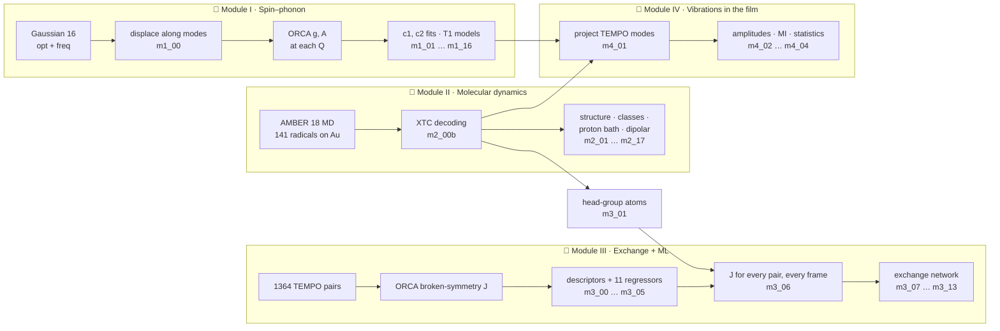

<div align="center">
🧲 Noise in Qubits
Packed closely, coupled in clusters: spin–phonon response and dynamic exchange in a TEMPO monolayer on gold
An atom-by-atom look at why a dense layer of radical spin qubits on gold stays coherent for microseconds


</div>
---
✨ The story in 30 seconds
Tesi et al. (Adv. Mater. 2023, 35, 2208998) clicked TEMPO radicals onto a gold monolayer. The spins sit only ~6 Å apart, yet they stay coherent for 6–14 µs. That is three to four times longer than the same radical in frozen solution. Three questions were left open:
❓ Open question	🔬 What we did	💡 What we found
What drives spin–lattice relaxation (T₁)?	DFT scans of g and A along every soft vibration (linear c₁ and quadratic c₂ terms) + fits of the measured T₁(T)	A direct process below ~30 K and a local vibration of 100–140 cm⁻¹ above it. c₁ dominates in 37 of 42 scans, and c₂ in 5. The isolated-molecule couplings do not pick out the relaxing vibration.
How are the radicals arranged and how do they move?	All-atom MD of 141 radicals on gold, 3 runs × (100 K, 300 K) × 10 ns	Upright chains and four radical classes (frozen, restricted, mobile, surface-bound). The proton bath is almost as dense as in solution. Dipolar couplings of ~230 MHz are not averaged.
How strong is exchange, and with which sign?	1364 broken-symmetry DFT couplings → machine learning → J for all 9870 pairs in every frame	Small, mostly antiferromagnetic clusters (median |J| ≈ 0.2 cm⁻¹) that motion makes and breaks. Inside a cluster, exchange is ~60× the dipolar width. There are no couplings of hundreds of kelvin.
---
📊 Key numbers (all 141 radicals; mean ± SD over three runs)
Quantity	100 K	300 K
Interior chain tilt	20 ± 2°	27.5 ± 1.1°
N–O order parameter S² (cone semi-angle)	0.947 ± 0.007 (10°)	0.74 ± 0.03 (25°)
Mean nearest-neighbor spin–spin distance	5.88 ± 0.04 Å	6.30 ± 0.03 Å
Local dipolar width √M₂ (B₀ ∥ surface normal)	273 ± 8 MHz	232 ± 16 MHz
Protons 4–8 Å from each spin	58 ± 1	53 ± 2
Resolved exchange pairs (|J| > 0.1 cm⁻¹)	78 ± 2	63 ± 7
Radicals without a resolved partner	27 ± 2 %	40 ± 5 %
Antiferromagnetic share of resolved couplings	73 ± 1 %	70 ± 1 %
Median resolved ⟨|J|⟩	0.23 ± 0.04 cm⁻¹	0.18 ± 0.02 cm⁻¹
Other results:
Local-mode energy from the T₁ fits: Δ = 139 ± 10, 124 ± 14 and 102 ± 21 cm⁻¹ for the slow and fast solution components and for the monolayer.
ML model on 205 held-out DFT pairs: R² = 0.77, and 70 % of resolved couplings fall within a factor of 3.
The sign of J is hard to learn from geometry (AUC 0.50–0.63). It is therefore reported as a probability, P_AF.
> ⚠️ **About the 14 "close-pair" molecules.** In the common starting structure, seven pairs of molecules (residues 2428, 2440, 2441, 2455, 2485, 2486, 2495, 2508, 2512, 2527, 2528, 2529, 2533, 2537) are anchored 3.1–3.3 Å apart, so their TEMPO rings interpenetrate.
> - **They are included in every analysis.** They give the largest couplings (|J| ≈ 6 cm⁻¹), which lie outside the applicability domain of the ML model.
> - Set `TEMPO_EXCLUDE_DEFECTS=1` to rerun everything without them. `m5_compare_close_pairs.py` then builds the with/without table.
---
🗺️ How the pieces fit together

---
📁 Repository layout
```
noise_in_qubits/
├── README.md                     ← you are here
├── LICENSE                       MIT
├── requirements.txt              pip dependencies
├── environment.yml               conda environment
├── run_all.sh                    one command to regenerate every result from the stored data
├── docs/                         detailed theory, inputs and script notes (00–05)
├── python_codes/                 all analysis code (m1_*, m2_*, m3_*, m4_*, m5_*)
│   ├── config.py                 every file path in one place (override with environment variables)
│   ├── plot_style.py             common figure style (large fonts, bright colors, no legend frames)
│   └── xtc_reader/xtc2bin.c      stand-alone GROMACS-XTC decoder (C, no dependencies)
├── simulation_inputs/
│   ├── ModuleI/                  scan notebook, PTEMPO-alkyl frequency log, mode compositions, Wigner samples
│   ├── ModuleII/                 tleap, force-field files, topologies, AMBER inputs
│   └── ModuleIII/                pair generator, contact filter, ORCA inputs, 1364 geometries, J values
├── data/                         processed data (module1 … module4): the inputs of every figure and table
├── tables/                       LaTeX tables written by the scripts
├── Figures_MS/  Figures_ESI/     figures written by the scripts
└── paper_V4/                     Manuscript_V4.tex, ESI_V4.tex, References_V4.bib, latexmkrc, aux, bbl, PDFs,
                                  Figures_MS_V4/, Figures_ESI_V4/, tables_V4/
```
---
🚀 Quick start (step by step)
Step 1: Get the code
```bash
git clone https://github.com/compchemsk/noise_in_qubits.git
cd noise_in_qubits
```
Step 2: Create the Python environment (choose one)
```bash
conda env create -f environment.yml && conda activate noise-in-qubits
# or
pip install -r requirements.txt
```
Step 3: Regenerate everything from the stored data (no MD trajectories needed)
```bash
bash run_all.sh
```
Step 4 (optional): Run one part only
Command	What it regenerates	Time
`bash run_all.sh m1`	Module I: couplings, c₁/c₂, T₁ models, Figure 2 and SI figures	~5 min
`bash run_all.sh m2`	Module II: MD statistics, classes, Figures 3–4 and SI figures	~5 min
`bash run_all.sh m3ml`	Module III: DFT library, descriptors, ML benchmark, sign analysis, final model	~30 min
`bash run_all.sh net`	Module III: exchange network, Figures 6–7 and SI figures and tables	~10 min
`bash run_all.sh m4`	Module IV: TEMPO vibrations inside the film, Figure 5	~5 min
`bash run_all.sh extra`	Structures figure (Figure 1) and TOC graphic	< 1 min
Step 5: Compile the paper
```bash
cd paper_V4
pdflatex ESI_V4 && bibtex ESI_V4 && pdflatex ESI_V4 && pdflatex ESI_V4      # ESI first
pdflatex Manuscript_V4 && bibtex Manuscript_V4 && pdflatex Manuscript_V4 && pdflatex Manuscript_V4
# or simply: latexmk -pdf Manuscript_V4   (latexmkrc builds the ESI first)
```
The figures used by the paper are already in `paper_V4/Figures_MS_V4/` and `paper_V4/Figures_ESI_V4/`. After you rerun the scripts, copy the new files from `Figures_MS/` and `Figures_ESI/` into these folders. `FigS_structures.png` goes into `Figures_MS_V4/`, because it is Figure 1 of the paper.
Step 6 (optional, experts): Start from the raw MD trajectories (~23 GB)
```bash
# put the trajectories in md_raw/{100K,300K}/rep{1,2,3}/TEMPO-SAM-11.xtc
cd python_codes
bash   m2_00b_decode_trajectories.sh      # XTC -> binary coordinates
python m2_01_validate_decoder.py          # checks every bond in every frame
python m2_02_extract_observables.py       # per-molecule, per-frame observables
python m2_07_pairs.py && python m2_08_convergence.py
python m2_13_spin_bath.py && python m2_14_dipolar_modulation.py
python m3_01_extract_md_headgroups.py     # nitroxide key atoms for the exchange model
python m3_06_apply_md.py                  # J for all 9870 pairs in every frame
python m4_01_mode_projection.py           # TEMPO modes projected in every frame
cd .. && bash run_all.sh                  # everything downstream
```
`m1_11_parse_orca_tensors.py` needs the ORCA output files of the tensor scans. Its result is already stored in `data/module1/orca_tensors/parsed_tensors.json`.
---
🖼️ Which figure comes from which script
Main-text figures (Manuscript_V4)
Paper figure	File	Script	What it shows
Figure 1	`Figures_ESI/FigS_structures.png`	`fig_structures.py`	Skeletal formulas of TEMPO, PTEMPO and PTEMPO-alkyl (the radical head of the monolayer, with SH in place of the Au–S bond).
Figure 2	`Figures_MS/Figure1_spin_phonon`	`m1_05_figures.py`	(a) Hyperfine and (b) g couplings of every soft vibration: |c₁| filled, |c₂| open, g as the line shift at 35 GHz. (c) Measured 1/T₁ of PTEMPO with the direct + local-mode fit and its two parts. (d) Local-mode share of 1/T₁ against temperature.
Figure 3	`Figures_MS/Figure2_monolayer_MD`	`m2_09_figures.py`	(a) Side views of the monolayer at 100 and 300 K. (b) Spin heights. (c) N–O orientation. (d) Cone angles. (e) Spin–spin distances; the small peak near 3 Å comes from the close pairs.
Figure 4	`Figures_MS/Figure3_radical_classes`	`m2_16_figures_classes.py`	(a, b) The four radical classes and their populations. (c) Class changes over time. (d) Proton bath compared with the solvent. (e) Dipolar width and its fluctuating part. (f) Correlated motion of neighbors.
Figure 5	`Figures_MS/Figure6_mode_environment`	`m4_04_figures.py`	The spin-active TEMPO vibrations inside the film: amplitudes by class, damping near gold, frozen spread of g and A (from c₁ and c₂), time correlation, mutual information, correlations with the surroundings.
Figure 6	`Figures_MS/Figure4_exchange_ML`	`m3_09_figures_ml.py`	(a) DFT exchange library. (b, c) Benchmark of 11 regressors and 6 descriptor sets. (d) Predicted against DFT |J| on the test pairs. (e) ROC curves for the sign. (f) Learning curves.
Figure 7	`Figures_MS/Figure5_exchange_network`	`m3_10_figures_network.py`	(a) 141 × 141 coupling map. (b, c) Exchange networks on the surface (close pairs ringed). (d) Distribution of couplings. (e) Partners per radical. (f) Partners by class.
TOC graphic	`Figures_MS/TOC_graphic`	`toc_graphic.py`	Table-of-contents graphic (3.25 × 1.75 in).
Supporting-information figures (ESI_V4)
ESI figure	File (`Figures_ESI/`)	Script	What it shows
S1	`FigS_functional_benchmark`	`m1_05_figures.py`	g and hyperfine error of PTEMPO for four methods (why B2PLYP).
S2	`FigS_wigner_TEMPO_PTEMPO`	`m1_10_wigner.py`	Wigner sampling: the NO geometry of TEMPO and PTEMPO is the same.
S3–S4	`FigS_scans_TEMPO_A`, `FigS_scans_TEMPO_g`	`m1_05_figures.py`	TEMPO scans with c₁, c₂ and the dominant term in each title.
S5–S6	`FigS_scans_PTEMPO_A`, `FigS_scans_PTEMPO_g`	`m1_05_figures.py`	PTEMPO scans with c₁ and c₂.
S7–S8	`FigS_scans_PTEMPO_alkyl_A`, `FigS_scans_PTEMPO_alkyl_g`	`m1_05_figures.py`	PTEMPO-alkyl scans with c₁ and c₂ (the one removed point is marked).
S9	`FigS_T1_model_fits`	`m1_05_figures.py`	Relaxation-model fits for the three data sets.
S10	`FigS_T1_multiprocess`	`m1_14_T1_figure.py`	Sums of relaxation processes, Δ profiles and model comparison (ΔBIC).
S11	`FigS_MD_convergence`	`m2_09_figures.py`	RMSD and block averages of all six runs.
S12	`FigS_MD_island_map`	`m2_09_figures.py`	Top view: interior, edge, gold-touching and close-pair molecules.
S13	`FigS_MD_tilt_gauche`	`m2_09_figures.py`	Chain tilt and gauche fraction.
S14	`FigS_MD_dynamics_pairs`	`m2_09_figures.py`	N–O correlation function, pair orientation and nearest-neighbor persistence.
S15	`FigS_class_portraits`	`m2_16_figures_classes.py`	Descriptor distributions of each class.
S16	`FigS_class_transitions_dipolar`	`m2_16_figures_classes.py`	Class changes at 100 and 300 K and decay of the dipolar fluctuations.
S17	`FigS_mode_tracking_checks`	`m4_04_figures.py`	Checks of the vibration tracking (coverage, ring filter, mutual information against distance).
S18	`FigS_exchange_dataset`	`m3_09_figures_ml.py`	The 1364-pair DFT library and its numerical noise.
S19	`FigS_exchange_importance_AD`	`m3_09_figures_ml.py`	Descriptor importance and applicability domain.
S20	`FigS_exchange_sign`	`m3_09_figures_ml.py`	Where the sign information lies; calibration of P_AF.
S21	`FigS_exchange_matrices_replicas`	`m3_10_figures_network.py`	Coupling maps of all six runs.
S22	`FigS_exchange_matrix_mean_sd`	`m3_10_figures_network.py`	Run-to-run mean and SD of the couplings.
S23	`FigS_exchange_network_replicas`	`m3_10_figures_network.py`	Surface networks of all six runs.
S24	`FigS_exchange_dynamics`	`m3_10_figures_network.py`	Time traces of persistent couplings and the averaging parameter ξ_J.
---
🧪 Which analysis comes from which script
> **Run order:** the order below is the order used by `run_all.sh`. Scripts marked **🗄️ raw** need the raw trajectories or ORCA outputs. Their results are already stored in `data/`.
🎵 Module I: Spin–phonon coupling and T₁ (`data/module1/`)
Script	What it does
`m1_00_displace_along_modes.py`	Builds geometries displaced along each normal mode, Q = −1 … +1 in steps of 0.2 (inputs for ORCA).
`m1_01_extract_scans.py`	Reads every g(Q) and A(Q) scan from the original notebook (`simulation_inputs/ModuleI/`) without retyping a number.
`m1_02_fit_couplings.py`	Fits each scan to X(Q) = c₀ + c₁Q + c₂Q² and gives the coefficients with standard errors; flags outlier points.
`m1_03_relaxation_models.py`	Fits the measured 1/T₁ with direct, Raman and local-mode models; tests DFT-weighted local modes.
`m1_04_mode_selection.py`	Inverse test: which computed vibrations are compatible with the measured T₁(T).
`m1_06_summary_numbers.py`	Computes every Module I number quoted in the text.
`m1_15_alkyl_composition.py`	Fragment composition of the PTEMPO-alkyl modes from its Gaussian log (UB3LYP/def2-TZVP).
`m1_07_latex_tables.py`	Writes the Module I LaTeX tables (couplings, composition, T₁ models).
`m1_16_c1_c2.py`	c₁ or c₂? Compares the two terms for all 42 scans and writes `tabS_c1c2.tex` and the thermal table (part from c₁, part from c₂, total).
`m1_08_thermal_modulation.py`	Thermal rms change of g and A with ⟨Q²⟩ = n + ½.
`m1_09_mode_character.py`	Links each vibration's composition (NO, ring, methyls, linker) to its coupling.
`m1_10_wigner.py`	Wigner-sampling statistics of the NO geometry of TEMPO and PTEMPO (and Figure S2).
`m1_11_parse_orca_tensors.py` 🗄️ raw	Parses the full g and hyperfine tensors from the ORCA outputs.
`m1_12_anisotropic_couplings.py`	Anisotropic couplings and powder-averaged spin-flip terms from the full tensors.
`m1_13_multiprocess_T1.py`	Direct + local-mode fits, sums of processes, Δ profiles, local-mode shares.
`m1_14_T1_figure.py`	Figure S10 and the multi-process table.
`m1_05_figures.py`	Figure 2 and Figures S1, S3–S9.
🌊 Module II: Molecular dynamics of the monolayer (`data/module2/`)
Script	What it does
`m2_00_io.py`	Shared tools: parm7 reader, trajectory loader, interior/edge groups, the list of close-pair molecules.
`m2_00b_decode_trajectories.sh` 🗄️ raw	Decodes the XTC trajectories with `xtc2bin.c`.
`m2_01_validate_decoder.py` 🗄️ raw	Checks all 10 293 bonds in all 6600 frames against their force-field lengths.
`m2_02_extract_observables.py` 🗄️ raw	Per-molecule, per-frame observables (heights, tilts, N–O vectors, gauche counts …) → `obs_*.npz`.
`m2_03_structure_stats.py`	Structure statistics: tilt, gauche share, heights, gold contacts, N–O orientation.
`m2_04_dynamics.py`	N–O reorientation: S², cone angle, correlation times.
`m2_05_S2_populations.py`	Are there one or two populations of cone angles? (Gaussian mixtures, BIC.)
`m2_06_mobility_determinants.py`	Which local descriptors go with mobility? (Spearman correlations.)
`m2_07_pairs.py` 🗄️ raw	Pair geometry: nearest-neighbor distances, dipolar couplings, persistence.
`m2_08_convergence.py` 🗄️ raw	RMSD and block averages for convergence.
`m2_11_radical_classes.py`	Gaussian-mixture classes; picks k with the lowest BIC among stable solutions (k = 4).
`m2_12_class_persistence.py`	Do radicals keep their class? (First vs second 5 ns.)
`m2_13_spin_bath.py` 🗄️ raw	Proton bath around each spin compared with the solvent.
`m2_14_dipolar_modulation.py` 🗄️ raw	Local dipolar width √M₂, its fluctuation and the averaging parameter ξ.
`m2_15_correlated_motion.py`	Do neighbors move together? (Height and orientation correlations against distance.)
`m2_10_tables.py` / `m2_17_tables_classes.py`	LaTeX tables for MD structure, dynamics, pairs, classes, bath and dipolar couplings.
`m2_09_figures.py`	Figure 3 and Figures S11–S14.
`m2_16_figures_classes.py`	Figure 4 and Figures S15–S16.
`reduce_module2_trajectories.py`	Optional helper that shrinks the raw MD files to a compact form.
🔗 Module III: Exchange coupling and machine learning (`data/module3/`)
Script	What it does
`m3_00_build_dataset.py`	Builds the training set from the 1364 DFT pairs (geometries + Yamaguchi J).
`m3_01_extract_md_headgroups.py` 🗄️ raw	Nitroxide key atoms of all 141 radicals in every analyzed frame.
`m3_features.py`	The 58 rotation- and label-invariant pair descriptors (geometry, contacts, π* overlap).
`m3_ml_common.py`	Shared ML settings: target asinh(|J|/0.05 cm⁻¹), seeds, data split.
`m3_02_features_training.py`	Descriptors of the 1364 pairs.
`m3_03_benchmark_models.py`	Nested cross-validation of 11 regressors × 7 descriptor sets.
`m3_04_sign_classification.py`	Can the sign of J be learned? (16 classifiers, AUC with bootstrap intervals.)
`m3_04b_sign_permutation.py`	Label-permutation test (1000 permutations) of the sign AUC.
`m3_05_final_model.py`	Final model: ExtraTrees size × logistic P_AF, conformal intervals, applicability domain.
`m3_06_apply_md.py` 🗄️ raw	Predicts J for all 9870 pairs in every analyzed frame.
`m3_07_exchange_network.py`	Network statistics: resolved pairs, partners, clusters, AF share, Weiss constant, ν_ex/√M₂, ξ_J.
`m3_08_sensitivity.py`	Sensitivity to the threshold J_res and to edge radicals.
`m3_12_revision_analyses.py`	Applicability domain of all predictions, random dilution, subsets, two-point dipoles, triplet zero-field splitting.
`m3_13_extra_tables.py`	LaTeX tables for those analyses and the X/Q/W-band dimer fractions.
`m3_11_tables.py`	LaTeX tables of Module III (models, descriptors, test set, sign, network, classes).
`m3_09_figures_ml.py`	Figure 6 and Figures S18–S20.
`m3_10_figures_network.py`	Figure 7 and Figures S21–S24.
🎯 Module IV: Spin-active vibrations inside the monolayer (`data/module4/`)
Script	What it does
`m4_01_mode_projection.py` 🗄️ raw	Aligns every TEMPO head on the DFT structure, filters distorted rings (> 0.3 Å) and projects onto the 78.3, 117.7 and 197.8 cm⁻¹ modes.
`m4_02_mode_information.py`	Amplitudes, frozen vs dynamic parts, δA and δν_g from c₁ and c₂, autocorrelations, mutual information.
`m4_03_radical_level.py`	Radical-level tests: how class and distance to gold shape each mode (Spearman with FDR control).
`m4_04_figures.py`	Figure 5 and Figure S17.
🧩 Extras
Script	What it does
`fig_structures.py`	Figure 1 (structures of the three radicals).
`toc_graphic.py`	TOC graphic.
`m5_compare_close_pairs.py`	Table of key results with and without the 14 close-pair molecules. Usage: `python m5_compare_close_pairs.py <tables_all_141> <tables_without_14> <out.tex>`.
`config.py`	All file paths; every one can be overridden by an environment variable.
`plot_style.py`	Common figure style.
---
📐 Conventions
Exchange: Ĥ = −2J Ŝ₁·Ŝ₂, so J < 0 is antiferromagnetic. J is given in cm⁻¹ (1 cm⁻¹ = 29.979 GHz = 1.4388 K), and the singlet–triplet gap is 2|J|. Tesi et al. use J_Tesi Ŝ₁·Ŝ₂, so J_here = −J_Tesi/2.
Vibrations: Q is the dimensionless normal coordinate, with ⟨Q²⟩ = n + ½. c₁ is the slope and c₂ the curvature of each scan. At |Q| = 1 they change g or A by |c₁| and |c₂|.
g as a frequency: δν_g = (ν_mw/g)·δg at ν_mw = 35 GHz (Q band).
Uncertainties: standard deviations over the three MD runs, unless stated otherwise.
Radicals: all 141 are used. `TEMPO_EXCLUDE_DEFECTS=1` leaves out the 14 close-pair molecules.
Reproducibility: every random step uses a fixed seed. Two complete runs of the pipeline gave identical numbers.
🛠️ Software
Program	Version	Used for
Gaussian 16		geometries and vibrations (ωB97X-D/def2-TZVP for TEMPO and PTEMPO; UB3LYP/def2-TZVP for PTEMPO-alkyl)
ORCA	5.0.1	g and A tensors (B2PLYP/EPR-II); broken-symmetry J (B2PLYP-D3(BJ)/EPR-II)
AMBER	18	MD (`sander.MPI`, `tleap`, `cpptraj`, `parmchk2`); GAFF + INTERFACE force field
Python	≥ 3.10 (tested 3.13)	NumPy, SciPy, pandas, scikit-learn, Matplotlib, joblib, Pillow
gcc	any	compiling the XTC decoder
📚 More documentation
File	Content
docs/00_installation.md	Installation
docs/01_spin_phonon_coupling.md	Module I theory and inputs
docs/02_molecular_dynamics.md	Module II setup, observables, classes, close pairs
docs/03_exchange_coupling_and_ML.md	Module III DFT, descriptors, models, network
docs/04_running_the_analysis.md	Running from processed data or from raw trajectories
docs/05_data_dictionary.md	Every data file and column
📝 Citation
If you use this code or data, please cite:
> S. Karmakar, A. A. Begg, M. Nath, S. Mishra, *Packed Closely, Coupled in Clusters: Spin–Phonon Response and Dynamic Exchange in a TEMPO Monolayer on Gold*, manuscript in preparation.
>
> L. Tesi et al., *Modular Approach to Creating Functionalized Surface Arrays of Molecular Qubits*, *Adv. Mater.* **2023**, *35*, 2208998.
⚖️ License
Code and documentation are released under the MIT License (see `LICENSE`).
📬 Contact
Soumyajit Karmakar and Sabyashachi Mishra (soumyajitkarmakar.iit@gmail.com)
Department of Chemistry, Indian Institute of Technology Kharagpur, India
